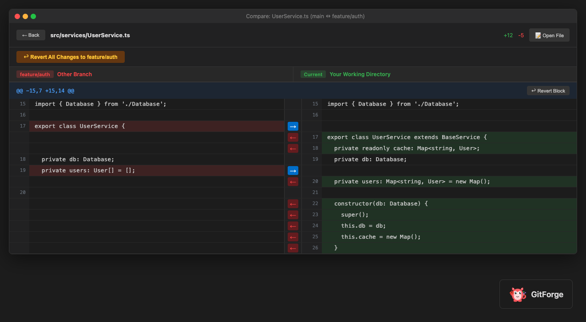
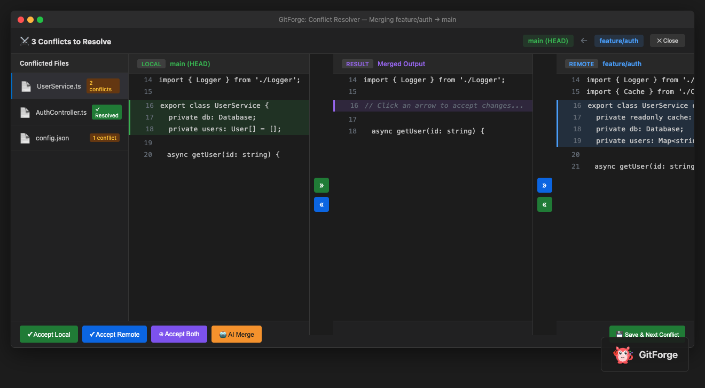

# GitForge

Advanced Git tools for VS Code, inspired by JetBrains IDEs.


**1.0.5** uses the forge-and-branch icon: a green and blue ring on an anvil. The same mark is the marketplace icon and the activity-bar icon.

## Screenshots

### Compare with Branch


### Conflict Resolver


## Features

### Inline Git Blame

See who made each change and when. Navigate through the complete history of any line.

- One-click blame: Click any line to see blame info
- Deep history: Navigate back through 100+ commits
- Hover details: Rich commit information on hover
- Relative dates: Shows "2 days ago" instead of timestamps

### Conflict Resolver

Opens when a merge leaves conflict markers. 1.0.3 shows a file list, then a three-column editor for the file you open.

What 1.0.3 does today:

- File list with Accept Local, Resolve, and Accept Remote
- Three columns: Local, Result, Remote
- Per-conflict actions: Use Local, Use Remote, Both
- Apply and stage once every conflict in the file is chosen
- Undo

What the marketplace mock in `screenshots/conflict-screenshot.html` shows, and what 1.0.5 will match:

- One screen: conflicted files on the left, the merge on the right
- Three panels with arrow columns between them: Local, Result, Incoming
- Green for local, purple for the result, blue for incoming
- Accept Local, Accept Remote, Accept Both, and Save and next conflict on the same bar
- Branch names in the header, and a resolved badge on each file

### Branch Management

Full-featured branch panel like WebStorm and IntelliJ.

- View all branches: Local and remote branches in one place
- Create branches: With optional checkout
- Rename branches: Quick rename from context menu
- Delete branches: With force delete option
- Merge branches: Direct merge with conflict detection
- Push to remote: Push branches with upstream tracking
- Fetch updates: Fetch from remote with one click
- Search and filter: Find branches quickly
- Ahead and behind indicators: See commit differences at a glance

### Rollback Changes

Selectively rollback changes with a visual UI.

- All file states: Shows staged, unstaged, and untracked files
- Type filters: Filter by Modified, Added, or Deleted
- Search: Find files by name
- Diff preview: Double-click to view changes
- Batch rollback: Select multiple files to rollback at once
- Single file rollback: Rollback individual files with one click

### Merge Changes Panel

See all changes at a glance during merge operations.

- File tree view: All changed files organized by folder
- Change summary: Additions, deletions, modifications
- Quick navigation: Click to open any changed file
- Status indicators: See staged, unstaged, and conflicted files

### Also in 1.0.3

- Compare with Branch: side-by-side diff, revert a hunk or the whole file
- Cherry-pick from a commit list
- Git log
- Stash and pop stash
- Fetch, pull, push, and commit
- Reset soft and reset hard

## Installation

### From VS Code Marketplace

1. Open VS Code
2. Go to Extensions (Ctrl+Shift+X on Windows, Cmd+Shift+X on macOS)
3. Search for "GitForge"
4. Click Install

### From VSIX

```bash
code --install-extension gitforge-1.0.5.vsix
```

## Usage

### Toggle Blame

- Command Palette: GitForge: Toggle Line Blame
- Editor title: the blame icon
- Click: Click on line number in gutter

### Show Line History

- Right-click on any line and select GitForge: Show Line History
- Or use Command Palette: GitForge: Show Line History

### Conflict Resolver

When conflicts are detected and `gitforge.conflictResolver.autoOpen` is on, GitForge opens the resolver. You can also open it manually:

- Command Palette: GitForge: Open Conflict Resolver
- Activity Bar: Click the GitForge icon, then Conflicts panel

### Merge Panel

- Activity Bar: Click the GitForge icon, then Merge Changes panel
- Command Palette: GitForge: Show Merge Changes Panel

### Branch Panel

Manage branches like in WebStorm and IntelliJ:

- Command Palette: GitForge: Branches...
- Right-click menu: Git, then Branches...

In the panel you can:
- Double-click a branch to checkout
- Click merge button to merge into current branch
- Click rename button to rename
- Click delete button to delete
- Click push button to push to remote

### Rollback Panel

Rollback unwanted changes:

- Command Palette: GitForge: Rollback Changes...
- Right-click menu: Git, then Rollback Changes...
- Single file: GitForge: Rollback This File

## Configuration

| Setting | Default | Description |
|---------|---------|-------------|
| gitforge.blame.enabled | true | Enable inline blame annotations |
| gitforge.blame.showOnHover | true | Show blame info on hover |
| gitforge.blame.format | {author}, {age} | Inline text. Tokens: {author} {age} {date} {message} {sha} |
| gitforge.blame.ignoreWhitespace | true | Skip whitespace-only blame |
| gitforge.blame.ignoreRevs | true | Use .git-blame-ignore-revs when the file exists |
| gitforge.blame.dateFormat | relative | Date format: relative, absolute, short |
| gitforge.blame.maxHistoryDepth | 100 | Max commits in line history and file history |
| gitforge.graph.maxItems | 200 | Max commits in the commit graph |
| gitforge.issueLinking.enabled | true | Link #123 in commit subjects |
| gitforge.conflictResolver.autoOpen | true | Auto-open on conflicts |
| gitforge.mergePanel.showOnMerge | true | Auto-show during merge |

## Keyboard Shortcuts

| Command | Windows and Linux | macOS |
|---------|-------------------|-------|
| Toggle Blame | Ctrl+Shift+B | Cmd+Shift+B |
| Show Line History | Ctrl+Shift+H | Cmd+Shift+H |
| Open Conflict Resolver | Ctrl+Shift+C | Cmd+Shift+C |

Ctrl+Shift+B is also VS Code's build-task shortcut. If both are bound, VS Code asks which command to run.

## Requirements

- VS Code 1.85.0 or higher
- Git installed and available in PATH
- A Git repository open in workspace

## What's new in 1.0.5

These sit next to the tools already in 1.0.3. They follow the local Git ideas in [GitLore](https://marketplace.visualstudio.com/items?itemName=RajpratapsinghJadon.gitlore): graph, history, and blame. GitForge does not add GitLore's pull-request board.

### Icon

The red mascot is gone. The icon is a ring (green on the left, blue on the right) with two nodes, standing on a blue anvil. `resources/icon.png` is the marketplace tile, with the navy background. `resources/gitforge-icon.svg` is the nav glyph: the same mark, with no background tile, so it sits in Cursor’s activity bar, including when that bar is on the bottom.

The status bar item on the bottom left is the current branch in brand blue (`#4C9AFF`). It no longer uses the generic source-control icon or the theme’s prominent status color.

### Commit graph

Command Palette: GitForge: Show Commit Graph. Also on the Source Control title bar.

- Working changes stay pinned at the top and open the Source Control view
- Each commit sits on a lane, with branch and tag labels
- Filter by message, author, or SHA
- Click a row for the files and the patch

### Commit details and actions

On the selected commit:

- Copy SHA
- Open the commit on GitHub, GitLab, or Bitbucket when the remote is one of those hosts
- Checkout
- Reset soft, mixed, or hard (asks first)
- Revert, cherry-pick, create a branch, or tag

`#123` in the subject becomes a link to that host's issue tracker. Turn it off with `gitforge.issueLinking.enabled`.

### Line history

Hover a blamed line and use Older or Newer. The inline text and the status bar show which revision you are on, as `2/12` plus the commit. Show History still fills the Blame History view.

### File history

The File History view lists commits that touched the active file, following renames. Refresh it from the view title, or run GitForge: Show File History. Click a row to open that commit in the graph.

### Blame options

- `gitforge.blame.format` controls the end-of-line text
- `gitforge.blame.ignoreWhitespace` passes `-w` to git blame
- `gitforge.blame.ignoreRevs` uses `.git-blame-ignore-revs` when that file is in the repo root

### Repository explorer

The Repository view has Branches, Remotes, Tags, and Stashes.

- Branch: checkout, merge into the current branch, delete
- Remote: open the host page in the browser
- Tag: delete
- Stash: apply, or drop after a confirmation

### Merge-base compare

GitForge: Compare Merge Base... asks for the other ref. It uses `git merge-base`, then shows:

- Ahead: commits on your branch that the other ref does not have
- Behind: commits on the other ref that you do not have
- Changed files: the diff from the merge base to your branch

Click a file to open it.

## License

MIT License, John Yaghobieh

---

Made by John Yaghobieh
